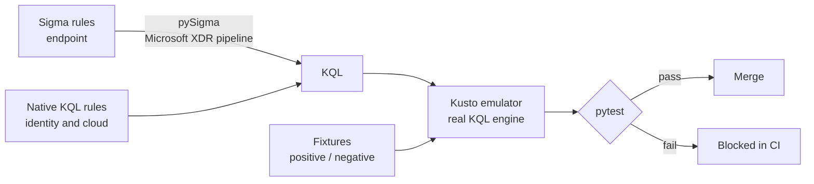

# sentinel-detection-as-code

[](https://github.com/Dheeraj880/sentinel-detection-as-code/actions/workflows/detections.yml)

Detection-as-code for **Microsoft Sentinel and Defender XDR**. Every detection is version-controlled, converted to KQL, and **executed against a real Kusto engine in CI** with should-fire and should-not-fire test data. A broken or noisy rule cannot be merged.

**16 detections · 16 MITRE ATT&CK techniques · endpoint, identity and cloud**

## How it works



1. **Endpoint detections are written in [Sigma](https://sigmahq.io/)**, the vendor-neutral detection format, and converted to Defender XDR KQL with pySigma. Field names are mapped automatically (`Image` → `FolderPath`, `CommandLine` → `ProcessCommandLine`, `ParentImage` → `InitiatingProcessFolderPath`).
2. **Identity and cloud detections are written in native KQL**, because they correlate many events over time (`summarize`, `join`, `mv-expand`), which single-event Sigma rules cannot express.
3. **Each rule has fixtures**: JSON log rows that it must fire on (`positive*.json`) and look-alikes it must ignore (`negative*.json`). The test harness loads them as in-memory tables with the real table schema and runs the rule's KQL against them in the [Kusto emulator](https://learn.microsoft.com/azure/data-explorer/kusto-emulator-overview), the same query engine that powers Sentinel.
4. **CI runs all of it on every push and pull request**, and fails if a rule has no positive or no negative fixture, or if the ATT&CK coverage map is out of date.

## Detections

| Detection | Data source | Type | ATT&CK |
|---|---|---|---|
| LSASS memory dump via comsvcs.dll MiniDump | DeviceProcessEvents | Sigma | T1003.001 |
| PowerShell encoded command | DeviceProcessEvents | Sigma | T1059.001, T1027 |
| Certutil used to download a file | DeviceProcessEvents | Sigma | T1105 |
| Mshta executing remote or inline script | DeviceProcessEvents | Sigma | T1218.005 |
| Regsvr32 Squiblydoo scriptlet execution | DeviceProcessEvents | Sigma | T1218.010 |
| Volume shadow copy deletion | DeviceProcessEvents | Sigma | T1490 |
| Office application spawning a shell | DeviceProcessEvents | Sigma | T1204.002 |
| Password spray against Entra ID | SigninLogs | KQL | T1110.003 |
| MFA fatigue (repeated MFA failures, then success) | SigninLogs | KQL | T1621 |
| Impossible travel (two countries within one hour) | SigninLogs | KQL | T1078.004 |
| Legacy authentication sign-in | SigninLogs | KQL | T1078.004 |
| Brute force followed by successful sign-in | SigninLogs | KQL | T1110.001 |
| User consent granted to an application | AuditLogs | KQL | T1528 |
| Member added to a privileged Entra ID role | AuditLogs | KQL | T1098.003 |
| Credentials added to an application or service principal | AuditLogs | KQL | T1098.001 |
| Inbox rule forwarding mail to an external address | OfficeActivity | KQL | T1114.003 |

Full technique-to-detection mapping: [`coverage/COVERAGE.md`](coverage/COVERAGE.md). For the matrix view, load [`coverage/attack-layer.json`](coverage/attack-layer.json) in [ATT&CK Navigator](https://mitre-attack.github.io/attack-navigator/) (Open Existing Layer → Upload from local). Both files are generated from rule tags by `coverage.py`, and CI fails if they are stale.

## Testing approach

- **Negative fixtures are designed to catch false positives, not just to be "different".** For example, the encoded PowerShell rule's negative fixture includes `-Encoding UTF8`, which a naive `-enc` match would flag. The privileged-role rule's negative fixture includes a *group* named "Global Administrator Fans", to prove the rule checks the role field rather than matching text.
- **Correlation rules are tested at their boundaries**: just under the threshold, the right events outside the time window, and failures that never lead to a success.
- **Multi-variant rules get one positive fixture per variant** (e.g. `positive_vssadmin.json` and `positive_wmic.json`), so one variant breaking cannot be hidden by the other still firing.
- **Tests are proven to fail.** Breaking a rule on purpose (e.g. changing `MiniDump` to `MiniDumpX`) makes its positive test fail with a clear message.
- **Schemas mirror the real Microsoft tables**, including quirks such as `SigninLogs.ResultType` being a string and `OfficeActivity.Parameters` being a JSON string that rules must `parse_json`.

## Repository layout

```
rules/
  sigma/endpoint/        Sigma rules (converted to KQL)
  kql/identity/          Native KQL: SigninLogs
  kql/cloud/             Native KQL: AuditLogs, OfficeActivity
schemas/                 Column names and types for each table
tests/
  fixtures/<rule-id>/    positive*.json and negative*.json per rule
  test_detections.py     Test harness (runs KQL in the Kusto emulator)
detections.py            Loads all rules; converts Sigma to KQL into build/
coverage.py              Generates the ATT&CK coverage files
coverage/                Generated coverage (do not edit by hand)
.github/workflows/       CI
```

## Run it locally

Requires Python 3.10+ and Docker.

```bash
# 1. Start the Kusto emulator (first pull is a few GB)
docker run -d --name kustainer -e ACCEPT_EULA=Y -p 8080:8080 -m 4G \
  mcr.microsoft.com/azuredataexplorer/kustainer-linux:latest

# 2. Install dependencies
python -m venv .venv
source .venv/bin/activate          # Windows: .venv\Scripts\Activate.ps1
pip install -r requirements.txt

# 3. Convert, test, and regenerate coverage
python detections.py
pytest -v
python coverage.py
```

## Adding a detection

1. Add the rule to `rules/sigma/endpoint/` (Sigma) or `rules/kql/<area>/` (native KQL), with a unique UUID `id` and `attack.*` tags.
2. Create `tests/fixtures/<rule-id>/` containing at least one `positive*.json` and one `negative*.json`.
3. Run `pytest -v` and `python coverage.py`, then commit the regenerated `coverage/` files.

## CI

The [`detections`](.github/workflows/detections.yml) workflow starts the Kusto emulator as a service container, converts the Sigma rules, runs the full test suite, and checks that the coverage files are current. Third-party actions are pinned to commit SHAs, the workflow token is read-only, and checkout credentials are not persisted.

## Limitations

- **Tested against synthetic fixtures, not yet validated against live telemetry.** The next phase validates every rule in a lab Microsoft 365 E5 + Sentinel tenant, using Atomic Red Team on a test VM, and replaces the synthetic fixtures with sanitized real log samples.
- **Thresholds are lab-sized** (e.g. 5 users for password spray). Production values depend on the size of the organization and its baseline.
- **Impossible travel is a simplified country-hop rule.** Production versions compute geo distance and travel speed, and exclude known VPN egress IPs.
- **Rules are not deployed automatically.** Deploying to a Sentinel workspace (e.g. via ARM/Bicep or the Sentinel API) is out of scope for now.

## Author

Dheeraj Shaik
